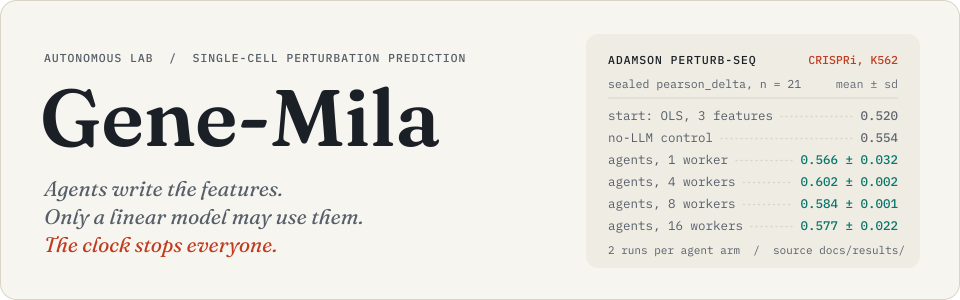

<p align="center">
  <picture>
    <source media="(max-width: 600px)" srcset="docs/assets/hero-narrow.svg">
    
  </picture>
</p>

Gene-Mila is a research lab run by LLM agents against a wall clock. Give it a single-cell
perturbation screen and a deadline (`--hours 6`): Claude plans as the principal investigator,
cheap worker models each turn one hypothesis into one feature, and Python fits a ridge, lasso,
elastic net or OLS model, scores it, and kills everything when time is up. The outer model never
gets cleverer, so every gain arrives as a named feature with a coefficient, and every feature is
a committed file of numpy, scipy or scikit-learn code that a person can read.

**The question.** Gene-Mila asks how far LLM agents can take a linear model on perturbations
held out of training, within a fixed time budget, and which signals the gain comes from. The
task is the unpaired one: given control cells and the identity of a held-out genetic
perturbation, predict every gene's change in mean expression. Held out means that none of the
perturbation's cells are used in training; perturbations, not cells, are split. The predictor is
linear on purpose: on this task, simple linear baselines have matched or beaten deep-learning
models (Ahlmann-Eltze, Huber and Anders, *Nature Methods* 2025), and a linear model keeps the
biology in the features, where it can be read.

> [!NOTE]
> Scores in the next two sections come from real Perturb-seq screens, Adamson 2016 and Norman
> 2019, on CellForge's datasets. The synthetic screen after them, with known biology, checks the
> machinery and is labelled as such.

## Results on Adamson

The Adamson et al. 2016 screen of the unfolded protein response (CRISPRi in K562 cells) has 88
knockdowns; the bundle keeps 2,055 genes (2,000 highly variable genes plus every target).
CellForge's seed-42 split by perturbation gives 50 training, 17 visible-validation and 21 sealed
perturbations. Each run lasts 20 minutes; Claude Opus plans and DeepSeek workers write the
features. A run picks its finalists on the visible score only, each finalist is scored once on
the sealed set after the deadline, and the number reported is the sealed score of the finalist
with the best visible score, never the best sealed one.

| Sealed set, n = 21 | Runs | pearson_delta ↑ | MSE, top-20 DE ↓ | R², top-20 DE ↑ |
|---|---|---|---|---|
| Linear regression, refit on the same split | 1 | – | 0.160 | 0.714 |
| Starting model: OLS on three built-in features | 1 | 0.520 | 0.154 | 0.734 |
| No-LLM control: fixed scripted hypotheses | 6, identical | 0.554 | 0.145 | 0.756 |
| No-LLM control plus one hand-written transfer feature | 1 | 0.593 | 0.142 | 0.755 |
| Agents, 1 worker | 2 | 0.566 ± 0.032 | 0.109 ± 0.005 | 0.817 ± 0.006 |
| Agents, 4 workers | 2 | 0.602 ± 0.002 | 0.117 ± 0.002 | 0.803 ± 0.003 |
| Agents, 8 workers | 2 | 0.584 ± 0.001 | 0.119 ± 0.003 | 0.802 ± 0.001 |
| Agents, 16 workers | 2 | 0.577 ± 0.022 | 0.111 ± 0.009 | 0.816 ± 0.020 |
| Agents, 4 workers, cross-validated selection, Opus planner | 2 | 0.594 ± 0.009 | 0.124 ± 0.008 | 0.791 ± 0.017 |
| Agents, 4 workers, cross-validated selection, DeepSeek V4 Pro planner | 2 | 0.570 ± 0.044 | 0.133 ± 0.022 | 0.776 ± 0.038 |

Mean ± sd over runs. pearson_delta is the Pearson correlation between predicted and measured
change from control over all 2,055 genes, per perturbation, averaged; the DE columns use each
perturbation's 20 most changed genes, CellForge's definition. Sources:
[`summary_for_collaborators.md`](docs/results/summary_for_collaborators.md),
[`results_table.md`](docs/results/results_table.md) (every arm, labelled by code version, in
CellForge's Table 1 layout) and [`scaling.md`](docs/results/scaling.md) (cost, throughput and
significance by arm).

- **Agents average above the fixed recipe, modestly.** Every agent arm's mean is above the
  starting model and the no-LLM control on sealed pearson_delta, and above every refit baseline
  and the control on the DE columns. For the 1-worker and DeepSeek-planned arms the pearson_delta
  margin (+0.012, +0.016) is inside their run-to-run spread (sd 0.032, 0.044), and two agent runs
  scored below the control (0.544 and 0.538).
- **The gain is one idea.** Nearly all of it is one feature family: transferring the measured
  responses of training knockdowns whose targets share gene sets or protein-interaction
  neighbours with the new target. Given one hand-written feature of that kind, the no-LLM control
  reaches 0.593, level with the agent arms on pearson_delta; the agents keep their lead on the DE
  columns.
- **More workers bought throughput, not accuracy.** From 1 to 16 workers, experiments completed
  per run rose from 88 ± 8 to 690 ± 46 and DeepSeek cost per run from $0.182 ± 0.015 to
  $1.287 ± 0.125, while the sealed score did not rise. Of the six worker-count pairs only 4
  against 8 workers exceeds run-to-run noise (Welch p = 0.01, two runs per arm). Most of a run's gain
  arrives in its first half ([`time_to_best.md`](docs/results/time_to_best.md)).
- **The limit is information about the targets.** Under cell-sampling noise alone a perfect
  predictor would score about 0.944 on the 17 visible-validation perturbations; the selected
  models of 28 runs reach 0.563 to 0.664 there ([`noise_ceiling.md`](docs/results/noise_ceiling.md)).
  Longer runs, refits on more labels and pruning to a compact model did not help
  ([`LAB_STATE.md`](docs/LAB_STATE.md)).
- **An external screen adds information; how much is not established.** The Replogle 2022
  genome-wide K562 screen measures most of the same knockdowns in another experiment.
  Leave-one-out on the 50 training perturbations, without touching the sealed set, a ridge stack
  that uses it scores 0.616 ± 0.233 against 0.545 ± 0.264 for gene-set nearest-neighbour
  transfer, a paired gain of +0.072 ± 0.020 (SE), better on 34 of 50
  ([`external_loo_replogle2022_k562.md`](docs/results/external_loo_replogle2022_k562.md)); the
  same stack without the screen's columns scores 0.543 ([`LAB_STATE.md`](docs/LAB_STATE.md)). A
  no-LLM run that adds the screen's features to those of one Opus-planned agent run reads 0.646
  on the sealed set, in one run. That set had already been scored for dozens of finalists across
  about 30 runs, so 0.646 is one more look at a used set, not a result; Norman is the clean
  test.
- **Left out on purpose.** All-gene MSE, PCC and R²: every model in the table, and predicting no
  change at all, has an all-gene PCC between 0.979 and 0.987, so those columns cannot separate
  models. And a comparison with CellForge's published rows: their evaluation code is
  unpublished, no metric definition reproduces their own baseline rows (they report the
  unperturbed baseline at PCC 0.0001; on this data it scores 0.98), and their split holds out
  guides, not genes.

### Norman 2019: a first pre-specified reading

The Norman et al. 2019 screen (CRISPRa activation in K562, single genes and gene pairs) is the
clean test, because its sealed set is read only at points fixed in advance
([`NORMAN_PLAN.md`](docs/NORMAN_PLAN.md)). The bundle has 231 perturbations on a split that keeps
every held-out single gene out of training: 112 training, 63 visible and 56 sealed. Two no-LLM
controls and one agent run, one run each, are read against the additive baseline (a pair
predicted as control plus its two single-gene responses) under a rule fixed before any run: a
gain counts when it exceeds twice its paired standard error and wins on more than half the
perturbations.

| Sealed set, n = 56 | pearson_delta | minus additive (paired SE) | Better on |
|---|---|---|---|
| Additive baseline | 0.713 | | |
| No-LLM control | 0.717 | +0.004 ± 0.008 | 28 of 56 |
| No-LLM control with the Replogle screen | 0.719 | +0.006 ± 0.007 | 32 of 56 |
| Agents with the screen: best agent-built model | 0.671 | no paired reading | |

Neither control is established above the additive baseline on the sealed set, although on the 175
visible and out-of-fold training perturbations both led it (+0.030 ± 0.009 and +0.031 ± 0.008,
paired SE): selection overfits the perturbations it chooses on. The screen adds +0.002 ± 0.001
(paired SE) pooled, better on 40 of 56, which passes the rule but is too small to matter, and is
not established on single genes
([`norman_sealed_reading.md`](docs/results/norman_sealed_reading.md)).

The agent run (DeepSeek planner and workers, 4 workers, 20 minutes, the screen in its bundle, no
warm start) selected the additive baseline itself, because no agent-built model beat it on the
visible score, so the pre-specified paired reading has nothing to compare. Its best agent-built
model scores 0.671 on the sealed set against 0.713 for the additive rule. No agent built the
additive prediction as a feature, and 1 of 355 plugins read the screen
([`NORMAN_PLAN.md`](docs/NORMAN_PLAN.md), section 8). That says how the agents were started, not
anything about the biology: the scripted control leads because a hand-written template puts the
additive rule into its model. The next run is set to start the agents from that model.

## What one run looks like, on a synthetic screen

<p align="center">
  <picture>
    <source media="(max-width: 600px)" srcset="docs/assets/example-run-narrow.svg">
    
  </picture>
</p>

Before the real screens, the lab was checked on a synthetic one whose biology is known. Claude
Opus planned and four Claude Haiku workers wrote code against a synthetic knockout screen: 300 genes, 1,000 control cells and 80 single-gene knockouts (48 for training, 16 for
visible validation, 16 sealed), generated from gene modules and a sparse regulatory network.
The agents could read prior knowledge: module gene sets and a regulatory network, both partly
wrong on purpose, and the exact list of transcription factors. The budget was 10 minutes. The
run ended itself at 5.6, when its four planner rounds were used up.

One worker-written feature did most of the work. `target_coexpression_e7`, the knocked-out
gene's co-expression row in control cells, took pearson_delta on visible validation from
0.6054 to 0.7633 (+0.1579). Two more steps added `target_knockdown_scaled_e24` (+0.0136), which
predicts the knocked-out gene's own drop, and `tf_gated_coexpression_e26` (+0.0007), reaching
0.7775. After the run, the sealed query-only set scored the top three models and the baseline,
one logged query each: the winner scored 0.7764 and the baseline 0.5942, so the gain held on 16
perturbations no agent was ever scored on. The last step is too small to separate from noise
on 16 perturbations. Summary, planner batch, research state and analysis are in
[`docs/example_run/`](docs/example_run/).

The same split, run with no LLM at all, does as well. The offline dry run in [Quick
start](#quick-start) uses a scripted planner (seven fixed hypotheses, then combinations of
those that helped, an alpha sweep and one lasso fit) and hand-written template features from
`genemila/providers/mock.py`. In 2 minutes and for $0 it reached 0.7702 on visible validation
and 0.7776 on the sealed set ([summary](docs/example_run/control_scripted_summary.md)), against
the agents' 0.7775 and 0.7764 for about $1.25 of recorded API cost. The control is
timing-sensitive, because its planner combines only results that have finished: three of four
runs of the same command gave 0.7702 and 0.7776, and one stopped a step earlier at 0.7683 and
0.7744. The agents, who never saw the templates, re-derived them: target co-expression adds
+0.1579 in the agent run and in the control. So this run shows that the machinery works and
that the agents reach a hand-written reference; it does not show what agents add beyond one.
That is the first question for real screens.

### A feature a worker wrote

Worker W000 wrote `tf_gated_coexpression`, the last and smallest step of the lineage, in one LLM
call, in its own git worktree, from a 30-line API reference and one example plugin. It takes
the knocked-out gene's co-expression row from control cells and splits it into two columns, one
used when the target is a transcription factor and one when it is not (excerpt;
[full file](docs/example_run/tf_gated_coexpression_e26.py)):

```python
@register
class TFGatedCoexpressionE26(Feature):
    name = "tf_gated_coexpression_e26"
    ...
    def compute(self, ctx: FeatureContext, perts: list[str], params: dict) -> np.ndarray:
        out = np.zeros((len(perts), ctx.n_genes, 2))
        tf_list = ctx.knowledge('transcription_factors')
        ...
        corr_matrix = ctx.gene_corr
        for i, p in enumerate(perts):
            ...
            target_corr = corr_matrix[target_idx, :].copy()
            ...
            is_tf = 1.0 if target_gene in tf_set else 0.0
            tf_part = target_corr * is_tf
            nontf_part = target_corr * (1.0 - is_tf)
            out[i, :, 0] = tf_part
            out[i, :, 1] = nontf_part
        return out
```

The synthetic run's final model is ridge (alpha = 100) on standardised features, so the
coefficients share one scale. This is the whole model:

| Feature | Written by | Coefficient |
|---|---|--:|
| `mean_response` | built in | +0.1040 |
| `target_knockdown_scaled_e24` | worker W000, EXP_0024 | +0.0948 |
| `target_coexpression_e7` | worker W002, EXP_0007 | +0.0404 |
| `tf_gated_coexpression_e26[0]` | worker W000, EXP_0026 | −0.0305 |
| `tf_gated_coexpression_e26[1]` | worker W000, EXP_0026 | −0.0254 |
| `is_target` | built in | +0.0121 |
| `control_mean` | built in | +0.0012 |

Read the co-expression rows together. `target_coexpression_e7` is the target's co-expression row
with its sign flipped, and `tf_gated_coexpression_e26` splits the same row (target entry zeroed)
by whether the target is a transcription factor. The three columns sum to zero on every row, so
the data cannot separate their weights and ridge's penalty divides them. Read together, they say
the same thing for both kinds of target: the more a gene is co-expressed with the knocked-out
gene in control cells, the lower its predicted change, slightly more so when the target is a
transcription factor. The signs differ only because e7 is negated. Only the transcription-factor
split is new information, and it added +0.0007.

### What the lab threw out

In the same synthetic run, EXP_0027 never reached a model. Its smoke test replaced training
perturbation G0000_KO's label with noise and the feature's rows for G0000_KO changed: the
feature was reading its own answer. The error went back to the worker, after one fix attempt
the feature still failed the same test, and the experiment was recorded as failed with the hint
`use ctx.train_delta(exclude=p)`. Twelve alpha settings that the planner proposed and the
controller expanded without another LLM call changed nothing at four decimals, and two worker
features made the model slightly worse (−0.0002 and −0.0030). All of it stays in `lab.db` next
to the wins.

### Cheaper workers, same rules

A second synthetic test ([report](docs/deepseek_test_2026-10-03.md)) kept Claude Opus as
planner and used DeepSeek workers. Four workers ran 11 experiments, each in its own worktree
commit, and none failed. The best feature, `net_diffusion_signed` (the knockout's signed
propagation through the prior regulatory network), reached 0.7980 on visible validation against
the same 0.6054 baseline, above the scripted control's 0.7702; the report records no sealed-set
score for that run. Recomputed from the recorded tokens at DeepSeek's peak rates, the workers
cost about $0.022 across the test's runs, or $0.0015 per experiment in the four-worker run; the
Claude planner reported $0.225. From the same measurements the report projects the next limit:
at 44 workers, one planner call every ~30 s with at most 20 hypotheses would cap supply near 40
experiments a minute, so the planner, not CPU or DeepSeek, would set the pace. The lab has since
been changed to run several planner rounds at once as the worker count grows
(`schedule.planner_concurrency`).

## How it works

<p align="center">
  <picture>
    <source media="(max-width: 600px)" srcset="docs/assets/loop-narrow.svg">
    
  </picture>
</p>

| Role | Who | Sees |
|---|---|---|
| Planner | Claude, through the `claude` CLI or the Anthropic API | A compressed research state of at most 20,000 characters (2,500 per section), however long the run. Called when the queue runs low; with many workers, several rounds run at once. |
| Workers | DeepSeek, Claude Haiku, or any OpenAI-compatible model | The spec, a 30-line API reference, one example plugin, short summaries of the data and the prior-knowledge files, and the names of the model's other features. Never the repository or the experiment history. |
| Controller | Python | Everything: deadline, queue, retries, concurrency, evaluation, the query-only oracle, SQLite. |

Six rules make a gain mean something. Each is enforced in code, not in a prompt.

| # | Rule | How the code enforces it |
|:-:|---|---|
| **1** | **The clock kills everything.** | A run gets `--minutes` or `--hours`. At the deadline the controller stops new experiments and LLM calls, gives running fits `run.shutdown_grace_s` (30 s), then kills them. `run_research.py` runs the lab as its own process group and SIGKILLs the group if it is still alive 180 s later, then writes the summary from `lab.db`. Completed models are kept. |
| **2** | **Linear models only.** | Ridge, lasso, elastic net or OLS, on CPU; any other model type is refused when the experiment is specified (`ALLOWED_MODELS` in `genemila/spec.py`). Fits run in a limited subprocess with a wall timeout, `RLIMIT_CPU` and `RLIMIT_AS`, and the controller picks alpha on visible validation. The rule binds the model fitted on the features; feature code may use numpy, scipy and scikit-learn, including models fitted on leave-one-out training responses. |
| **3** | **One new feature per experiment.** | A worker may change exactly one file, its plugin under `genemila/features/plugins/`, so a score change has one candidate cause. The diff guard rejects any other edit and any touch of the evaluator, data, splits or guards (`genemila/guard.py`). |
| **4** | **Numbers decide, never an LLM.** | The controller scores every experiment with its own evaluator (`genemila/benchmark/evaluator.py`). Ranking, sweeps, replicates, duplicate detection and scheduling are Python. |
| **5** | **The sealed set is read only after the run.** | Perturbations, not cells, are split 60/20/20 (or by an external split, `--splits`) into train, visible validation and query-only validation, hashed into a `split_id`. Experiments predict both validation sets without knowing which is which. Only `QueryOracle` reads the query-only labels, after the run: one query each for the top `final.top_k` distinct candidates and the best baseline, capped at `final.max_queries`, every query logged. |
| **6** | **Every feature is tested for leakage.** | Before a feature runs, the smoke test swaps one training perturbation's label for noise and checks that the feature's rows for it do not move. It also checks shape, NaN, determinism and constancy. An AST guard allows numeric imports only: no file I/O, network, processes or reflection. |

<details>
<summary>Also enforced: compute, spend, spec hygiene, integrity</summary>

| Guard | Mechanism |
|---|---|
| Compute | Per-experiment wall timeout, `RLIMIT_CPU` and `RLIMIT_AS` (Linux) plus RSS polling; one CPU-slot semaphore shared by all workers (`--cpu-slots`). |
| Spend | The worst-case cost of every LLM call is reserved before the call. A call that could cross a per-run cap or the cumulative per-provider cap in `runs/spend_ledger.sqlite` is refused before it reaches the provider. A circuit breaker pauses a provider after repeated API failures, for 60 s at first and up to 10 minutes. |
| Spec hygiene | Every experiment states a hypothesis and a rationale; at most 3 changes from its parent (more than 1 is flagged); no hidden-label, evaluator or split language; duplicate configurations are skipped. |
| Integrity | Dataset file hashes and the split id are verified at start. Each experiment's code is committed and pinned at `refs/genemila/<run>/<experiment>`. |
| Validation labels | Experiment subprocesses receive only `public.npz` (control cells, training labels, perturbation metadata) and predict every non-training perturbation; the controller scores them. |

</details>

### The prediction

For perturbation $p$ and gene $g$, one linear model shared across all rows predicts the change
in mean expression:

```math
\Delta_{p,g} \;=\; \bar{x}_{g \mid p} \;-\; \bar{x}_{g \mid \text{control}} \;\approx\; w^{\top} f(p, g) + b
```

A feature $f$ maps $(p, g)$ to one or a few numbers (`genemila/features/api.py`), so each
coefficient weighs one named signal for every perturbation and gene, as long as no feature is a
linear combination of others (see the note under the coefficient table). The primary metric is
`pearson_delta`: for each held-out perturbation, the Pearson correlation between predicted and
true change across genes, averaged over perturbations. Baselines run first: no change, the mean
training response, and OLS, ridge and lasso on control mean, leave-one-out mean response and a
target indicator. On the synthetic example run's visible validation they score 0 (a constant
prediction has no correlation), 0.4755 and 0.6054 (the three linear fits tie).

`pearson_delta` has two known soft spots. It correlates over every gene, the knocked-out gene
included, whose own drop is easy to predict. And it is measured against control, so a response
that all perturbations share scores well on its own; that is why the mean training response
reaches 0.4755 (the systematic-variation problem described by Systema, Viñas Torné et al.,
2025).

So that the numbers can sit next to published ones, every experiment is also scored with
CellForge's metrics (MSE, PCC and R² on mean expression, over all genes and over the top-20 DE
genes) and VCWorld's DE and direction classification metrics (`genemila/benchmark/comparable.py`).
They measure different things: CellForge's PCC correlates whole expression profiles, not
changes, so in the scripted control run it is 0.975 for the linear baseline and 0.980 for the
best model on visible validation ([summary](docs/example_run/control_scripted_summary.md)).

## Limitations

- **Adamson's sealed set is used, and Norman's is barely started.** Adamson's 21 sealed
  perturbations have been scored for dozens of finalists across about 30 runs. No run selects on
  a sealed number, but the hand-written transfer feature was designed after 26 sealed results had
  been read, and each new arm read there is one more look, so later readings on it are weaker
  evidence than the first. Norman's sealed set, read only at pre-specified points, is the clean
  test, and its one agent run so far did not reach the additive rule.
- **Few, short runs.** Two runs per agent arm, 20 minutes each, on one split. Most differences
  between arms are inside run-to-run noise. The no-LLM control is deterministic, so its six
  identical runs are not a noise estimate.
- **A small gain, of one kind.** The agents' lead over the fixed no-LLM control on sealed
  pearson_delta (+0.01 to +0.05 by arm, the smallest inside run-to-run spread) disappears
  against a control given one hand-written transfer feature, written after the agent runs had
  shown what works; their lead on the DE columns remains.
- **Features may learn.** A feature can fit its own model on training responses, leaving its
  own perturbation out (`knn_response_transfer_e8` was a nearest-neighbour transfer). The
  linear-only rule binds the outer model; reading a gain means reading its feature's code.
- **Recall or discovery.** On real genes, worker LLMs know the literature, so a gain may come
  from recalled biology rather than from the screen. Only a control that hides gene identities,
  for example by scrambling gene names, would separate the two.
- **Comparable metrics, not comparable runs.** CellForge's and VCWorld's metrics are
  reimplemented from their papers (`genemila/benchmark/comparable.py`), not run from their code;
  CellForge publishes no evaluation code and defines DE genes differently in its paper and its
  documentation, so both definitions are reported, and no definition reproduces its own baseline
  rows. cell-eval scores only the finalists, and the search itself optimises `pearson_delta`.
- **Means, not cells.** The lab predicts each perturbation's mean expression change, so
  cell-eval's distribution metrics see a point mass per perturbation. Cell-level predictions
  would need a noise or sampling model on top of the linear mean model.
- **Process-level guards, not a sandbox.** They stop accidental or naive leakage. A determined
  program running as the same OS user could still find the private label files on disk; for
  untrusted models, run experiments as a separate user or in a container, or move
  `QueryOracle` to a remote service.
## Where this is going

The paper this lab is built for asks three questions:

- **How far?** Within a fixed clock, how far past a scripted planner with hand-written features
  do agent-discovered features take a linear model on perturbations it has never seen? On
  Adamson: a little, and on pearson_delta not past a control given one more hand-written
  feature.
- **Which signals?** Which biology carries the gain, and how much of it comes from the screen
  rather than from what the models already know about these genes? On Adamson, transfer of
  responses between related knockdowns; leave-one-out, an external screen of the same
  knockdowns adds to it.
- **Does it hold?** Does the gain survive a set no agent tuned against, across repeated runs and
  datasets, under the same scoring as CellForge and VCWorld?

Gene-Mila stays a separate lab rather than a fork of CellForge or VCWorld, built to be compared
with both:

1. **CellForge's datasets.** Adamson is done (above). Norman has its bundle, a split that keeps
   held-out single genes out of training, the additive baseline, a recorded modality (CRISPRa)
   with sign-aware external features, and a reading rule fixed before any run; its first agent run
   did not reach the additive rule, and the next starts from the control's model. Srivatsan
   (sci-Plex 3) needs drug and dose ingestion.
2. **The same game.** `results_table.py` lays every arm out like CellForge's Table 1
   ([`results_table.md`](docs/results/results_table.md)), with Unperturbed, Random Forest and
   Linear Regression refitted on the same split and the paper's rows quoted from
   `docs/results/cellforge_table1.json`. Its calibration finds no metric definition that
   reproduces the paper's simple-baseline rows, so those rows stay marked as reported, not
   comparable. A real comparison needs CellForge's model run through this evaluation on the same
   split, which needs a GPU. VCWorld's benchmark is drug perturbations only, so until Gene-Mila
   has drug features the VCWorld comparison uses its DE and direction metrics on Adamson and
   Norman, not its data.

Drug perturbations (Srivatsan in CellForge's set, and all of VCWorld's GeneTAK) wait on drug
metadata: every feature today assumes a gene target, and the ingestor drops labels that name no
measured gene.

| | [CellForge](https://arxiv.org/abs/2508.02276) | [VCWorld](https://proceedings.iclr.cc/paper_files/paper/2026/file/767ff070c27c8954babe74eccf3fbe91-Paper-Conference.pdf) (ICLR 2026) | Gene-Mila |
|---|---|---|---|
| Agents produce | a trained perturbation-response model | differential-expression and direction-of-change predictions | features for a ridge, lasso, elastic net or OLS model |
| Data | six datasets spanning gene knockouts, drug treatments and cytokine stimulations (scRNA-seq, scATAC-seq, CITE-seq), including Adamson, Norman and Srivatsan | GeneTAK: 348 drugs in five Tahoe-100M cell lines (C32, HepG2C3A, HOP62, Hs 766T, PANC-1) | Adamson and Norman from CellForge's set; synthetic screens to check the machinery |
| Scored by | MSE, PCC and R² on mean expression, all genes and top-20 DE genes | DE and direction classification: accuracy, precision, recall, F1, AUROC, AUPRC | `pearson_delta` for the search; both of theirs on every experiment; cell-eval for finalists |

---

## Quick start

Needs Python 3.11 or newer.

```bash
pip install -r requirements.txt
python -m pytest -q                                   # about a minute

# offline dry run: mock workers + scripted planner, synthetic data, no API keys
# (the no-LLM control in docs/example_run/control_scripted_summary.md)
python run_research.py --minutes 2 --workers 4 --worker-provider mock --planner-provider scripted

# Claude plans, DeepSeek implements (needs DEEPSEEK_API_KEY and the claude CLI)
python deepseek_check.py                              # one minimal API call; prints tokens and cost
python run_research.py --minutes 3 --workers 1 --max-planner-calls 1   # one-worker cycle
python run_research.py --minutes 6 --workers 4 --max-planner-calls 2   # four-worker test

# the example run on this page (Claude Opus plans, Claude Haiku implements)
python run_research.py --minutes 10 --workers 4 --worker-provider claude_cli --worker-model haiku \
    --planner-provider claude_cli --planner-model opus --budget 1.5 --max-planner-calls 4
```

Watch a run, then take it apart:

```bash
python status.py                     # live state (add --watch 5)
python leaderboard.py                # ranked experiments; --all includes failures
python leaderboard.py --lineage EXP_0012
python summarize.py --state          # the compressed research state the planner sees
python summarize.py                  # regenerate the run summary (keeps stored query-only scores)
python run_research.py --dataset adamson_cf --minutes 20 --workers 4 --continue-from runs/<earlier run>
python reproduce.py --experiment EXP_0012
python analyze_run.py                # worker independence, tokens, cost, bottlenecks, projections
```

Every command defaults to the most recent run under `runs/`; pass `--run runs/<id>` to pick one.
`summarize.py` keeps the sealed-set scores a finished run already stored and makes no new
query; `--query-only` also scores any top candidate that has no stored sealed-set score yet.

### Scaling

```bash
# rehearsal with no API calls: 44 mock workers and an endless stream of distinct hypotheses
python run_research.py --minutes 5 --workers 44 --worker-provider mock --planner-provider loadtest

# paid runs; each raises the cumulative DeepSeek cap on purpose
python run_research.py --minutes 20 --workers 8  --budget 1.00 \
    --set budget.cumulative_usd.deepseek=10
python run_research.py --minutes 20 --workers 16 --budget 2.00 \
    --set budget.cumulative_usd.deepseek=10
python run_research.py --hours 1 --workers 44 --budget 5.00 \
    --set budget.cumulative_usd.deepseek=25
```

Experiments fork from a warm server process and reuse cached feature blocks within a run, which
on the mock benchmark cut CPU per experiment from 1.42 s to 0.07 s with bit-identical predictions
(see "CPU efficiency" in `docs/ARCHITECTURE.md`); set `--set experiment.executor="subprocess"`
to use a fresh interpreter per experiment instead. `--workers` sets LLM worker slots;
`--cpu-slots` (default: number of cores) caps simultaneous CPU experiments independently, so 44
workers on an 8-core machine queue politely for CPU while the others are writing code. Planner
calls are unlimited unless `--max-planner-calls` is set. The planner's own cap scales with
workers and hours (`budget.planner_usd_per_worker_hour`) and is paced over the run, so a long
run never spends it all at the start; new LLM calls are refused once any dollar cap is reached.
Raise `budget.cumulative_usd.deepseek` deliberately when you want to spend beyond the $0.25
development cap; the cumulative cap includes earlier runs' ledger spend, so a run halts partway
through when it is left at the default.

## Data

`python prepare_data.py synthetic` builds a small synthetic knockout screen with known
biology (gene modules → co-expression, a sparse regulatory network, a shared stress
response) plus prior knowledge (`gene_sets`, `prior_network`, `transcription_factors`; the
gene sets and the network are deliberately noisy). It is the fixture used for tests and
development.

Real data. The ingestor reads both layouts CellForge uses: scPerturb files (raw counts,
`obs['perturbation']`, e.g. `AdamsonWeissman2016_GSM2406681_10X010.h5ad` from
https://zenodo.org/records/13350497) and GEARS files (`perturb_processed.h5ad`,
`obs['condition']` with `GENE+ctrl`). It normalises raw counts (counts per 10k, log1p),
parses target genes out of labels (guides for the same gene are merged; `GENEA+GENEB`
doubles are kept), keeps highly variable genes plus every target gene, and splits by
perturbation. `--control` takes one or more control labels when none has a standard name.
`--splits` takes an external split instead of ours: train/val1/val2 or train/val/test lists,
or CellForge's train/test, whose test set becomes the query-only set while visible
validation is drawn from their training perturbations (`--val-frac`, default 0.25).

Prior knowledge for real screens: `python prepare_data.py knowledge` downloads curated
resources once (Reactome, GO Biological Process and MSigDB Hallmark gene sets, CollecTRI
signed TF-to-target regulation, STRING v12 physical interactions), and `--knowledge` filters
them to a bundle's genes. Resources derived from perturbation screens or expression atlases
are left out on purpose, so prior knowledge cannot encode the held-out responses.

```bash
pip install anndata cell-eval
python prepare_data.py describe AdamsonWeissman2016_GSM2406681_10X010.h5ad
python prepare_data.py knowledge                       # once; needs network access
python prepare_data.py h5ad --name adamson --knowledge data/raw/knowledge \
    --h5ad AdamsonWeissman2016_GSM2406681_10X010.h5ad --hvg 2000
python run_research.py --dataset adamson --minutes 20 --workers 4
```

### cell-eval

Each bundle also keeps, privately, the cells of held-out perturbations and a separate
sample of control cells. At the end of a run the finalists (and the best baseline) are
scored with Arc Institute's [cell-eval](https://github.com/ArcInstitute/cell-eval) on the
visible validation set, and on the query-only set as part of the same capped oracle query.
A prediction becomes (held-out control mean + predicted delta) repeated for each real
cell, as cell-eval's own mean baseline does, so pseudobulk metrics (pearson_delta, mse,
DE overlap/precision, discrimination score) are comparable with other methods while
distribution metrics treat the prediction as a point mass. Results land in
`summary.md` / `summary.json` and `runs/<run>/celleval/`. Turn it off with
`--set final.celleval=false`; `final.celleval_profile` picks the metric set.
Every experiment is also scored with CellForge's and VCWorld's published metrics
(see `docs/ARCHITECTURE.md`), and the summary has a table for each.

## Configuration

`configs/default.toml` holds every knob (workers, CPU slots, timeouts, RAM, retries,
exploration mix, providers and models, budgets, prices). Override with `--config my.toml`
or `--set section.key=value`. Model selection uses every visible perturbation: each experiment
also predicts the training perturbations out of fold (`experiment.cv_folds`, fixed folds per run,
set by the lab and not by agents) and the primary score averages those with the visible
validation set, so the search signal rests on 60-70 perturbations instead of 15-20.
`experiment.selection` names the selection score: `pearson_delta` (the default: correlation of the
predicted change, blind to its size) or `pearson_delta+r2_top`, which adds R² on each perturbation's
twenty most changed genes so a model that shrinks every change loses; `tools/replay_selection.py`
replays both rules over finished runs for free, on visible data only (select on one visible part,
score on the other), never on the sealed set. While the
planner thinks, `schedule.python_exploit` queues deterministic follow-ups around the best model
(add a helpful feature, ablate, refine alpha, swap the model family) so workers never idle; and
`final.ensemble` tries the average of the finalists as one more candidate for the sealed set, kept
only when it wins on the visible perturbations. `--continue-from runs/<earlier run>` warm-starts a
run on the same split from that run's useful features and best model, with a PRIOR CAMPAIGN
section in the planner's state. DeepSeek's models reason before answering by default and the
hidden reasoning counts against `worker.max_output_tokens`; the default `worker.thinking = "disabled"`
keeps the whole limit for code (set `"enabled"` plus `worker.reasoning_effort` to try it). DeepSeek prices are set to the
published peak-hour rates for `deepseek-flash` (what the API serves for `deepseek-chat`)
and `deepseek-v4-pro`; update `[pricing.*]` if they change, and run
`python reprice_ledger.py --apply` to recompute the spend ledger with new prices.

## Providers

`genemila/providers/` hides every model behind `AgentProvider` (`propose`, `implement`,
`diagnose`, `summarize`; a backend only needs `complete()`):
`claude_cli`, `anthropic`, `deepseek`, `openai_compat` (OpenAI, Grok, vLLM/Ollama/OpenCode
servers via `[providers.openai_compat] base_url / api_key_env`), and three that make no API
call: `mock` workers, the `scripted` planner, and the `loadtest` planner (an endless stream of
distinct hypotheses, for rehearsing many workers).
Escalation: set `worker.escalation_provider`/`escalation_model` and a failing cheap-model
implementation (after `llm_retries` fixes) is handed to the stronger model once.

## Outputs of a run (`runs/<id>/`)

`lab.db` (everything, failures included), `artifacts/EXP_xxxx/` (spec, every LLM attempt,
smoke reports, plugin file, predictions, fitted models, metrics, logs), `feature_store/`,
`planner/` (state given to the planner and its raw plans), `celleval/`, `controller.log`,
`summary.md`, `summary.json`, and `warm_start.json` when continued from an earlier run.
Experiment code is pinned at `refs/genemila/<run>/<experiment>`. Only the chosen alpha's
predictions are kept per experiment (`predictions.npz` for the held-out sets, `cv.npz` out of
fold for the training perturbations) and the feature cache is bounded
(`experiment.feature_cache_max_mb`); a run stops early when free disk drops below
`run.min_free_disk_mb`.

`python results_table.py build --runs runs/<...>` turns run summaries into a results table in
CellForge's Table 1 layout (`docs/results/`), and `results_table.py calibrate` checks which metric
definition reproduces the paper's simple-baseline rows.

## Architecture

<details>
<summary>Process tree: who owns what</summary>

```
run_research.py  (external watchdog: hard-kills the lab if it overruns, then writes the summary)
└── Controller  (owns deadline, scheduling, concurrency, retries, persistence; never an LLM)
    ├── Planner / PI ── LLMGateway ── Claude (claude CLI or Anthropic API)
    │      reads compressed research state, proposes hypotheses (JSON)
    │      Python expands sweeps, replicates, parents, explore/exploit/risky priorities
    ├── SQLite lab.db: queue, experiments (incl. failures), features, LLM calls, planner rounds
    ├── N worker slots (threads; 4 → 8 → 16 → 44 → 64 by --workers)
    │      claim → git worktree → [LLM writes ONE plugin file] → static guard → smoke test
    │      (shape, NaN, determinism, label-leakage) → diff guard → commit + pinned ref
    │      → CPU experiment subprocess (timeout, RAM, CPU limits; capped by --cpu-slots)
    │      → controller-side evaluation → record → feature store
    ├── LLMGateway: spend caps (per run, per role, cumulative per provider), token caps,
    │      bounded retries, circuit breaker, token/cost accounting for every call
    └── Final: query-only evaluation of top candidates and the best baseline,
           cell-eval when held-out cells exist, summary.md + summary.json
```

</details>

Module map, token and CPU budgets, failure handling and current limitations are in
[`docs/ARCHITECTURE.md`](docs/ARCHITECTURE.md). The figures on this page are drawn from the run
reports by [`docs/assets/build_figures.py`](docs/assets/build_figures.py).
