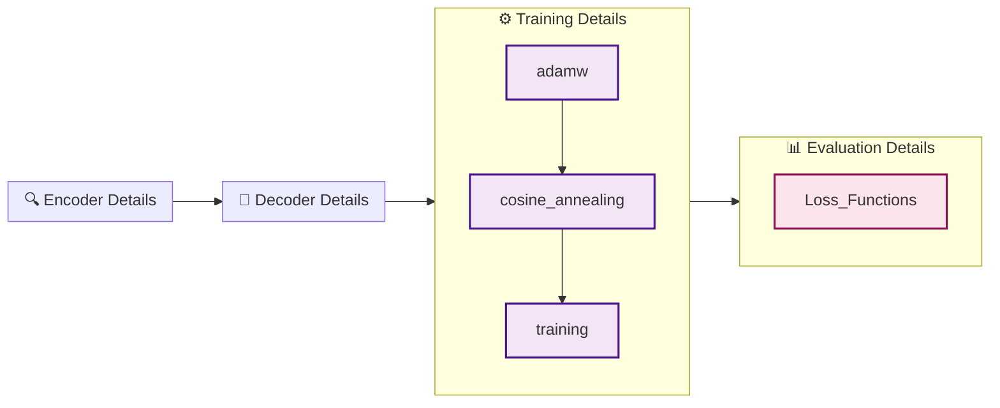

Generated on: 2026-10-30 14:12:05

# Research Framework Architecture

## System Overview
This diagram shows the complete research framework based on expert discussions and method refinement.

```mermaid
graph TD

    %% Data Input
    subgraph DataInput ["Data Input"]
        RawData["Raw Single-cell Data<br/>• Expression Matrix<br/>• Cell Metadata<br/>• Perturbation Info"]
        Metadata["Metadata<br/>• Cell Types<br/>• Batch Info<br/>• Conditions"]
    end

    %% Data Processing Pipeline
    subgraph DataProcessing ["🔧 Data Processing"]
        quality_control["quality_control<br/>"]
        normalization["log1p<br/>"]
        batch_correction["harmony<br/>theta=2, max_iterations=20"]
    end

    %% Model Architecture
    subgraph ModelArch ["🧠 Model Architecture"]
        encoder["transformer"]
        perturbation_encoder["mlp"]
        cross_attention["cross_attention"]
        decoder["mlp"]
    end

    %% Training Strategy
    subgraph Training ["🎯 Training Strategy"]
        optimizer["adamw<br/>"]
        scheduler["cosine_annealing<br/>"]
        training["training<br/>"]
    end

    %% Evaluation Metrics
    subgraph Evaluation ["📈 Evaluation"]
        loss_functions["Loss_Functions"]
    end

    %% Output
    subgraph Output ["📋 Output"]
        Predictions["Predictions<br/>• Expression Changes<br/>• State Transitions<br/>• Pathway Activities"]
        Insights["Biological Insights<br/>• Mechanism of Action<br/>• Drug Targets<br/>• Biomarkers"]
    end

    %% Data Flow
    RawData --> DataProcessing
    Metadata --> DataProcessing
    quality_control --> normalization
    normalization --> batch_correction
    batch_correction --> ModelArch
    ModelArch --> Training
    Training --> Evaluation
    Evaluation --> Output

    %% Styling
    classDef inputStyle fill:#e1f5fe,stroke:#01579b,stroke-width:2px
    classDef processingStyle fill:#f3e5f5,stroke:#4a148c,stroke-width:2px
    classDef modelStyle fill:#e8f5e8,stroke:#1b5e20,stroke-width:2px
    classDef trainingStyle fill:#fff3e0,stroke:#e65100,stroke-width:2px
    classDef evaluationStyle fill:#fce4ec,stroke:#880e4f,stroke-width:2px
    classDef outputStyle fill:#e0f2f1,stroke:#004d40,stroke-width:2px
    classDef subgraphStyle fill:#fafafa,stroke:#666,stroke-width:1px

    class RawData,Metadata inputStyle
    class quality_control processingStyle
    class normalization processingStyle
    class batch_correction processingStyle
    class encoder modelStyle
    class perturbation_encoder modelStyle
    class cross_attention modelStyle
    class decoder modelStyle
    class optimizer trainingStyle
    class scheduler trainingStyle
    class training trainingStyle
    class loss_functions evaluationStyle
    class Predictions,Insights outputStyle
    class DataInput,DataProcessing,ModelArch,Training,Evaluation,Output subgraphStyle
```

## Architecture Details

## Detailed Component Architecture

## Implementation Specifications

### Model Architecture Specifications

#### Encoder
- **type**: transformer
- **layers**: 4
- **heads**: 8
- **dimension**: 512
- **activation**: gelu

#### Perturbation Encoder
- **type**: mlp
- **layers**: 3
- **dimensions**: [256, 128, 64]
- **activation**: swish

#### Cross Attention
- **heads**: 8
- **dimension**: 512
- **dropout**: 0.1

#### Decoder
- **type**: mlp
- **layers**: 3
- **dimensions**: [256, 512, 1024]
- **activation**: swish

### Data Processing Pipeline

#### Quality Control
- **cell_filtering**:
  - min_genes: 200
  - max_genes: 6000
  - min_counts: 1000
  - max_counts: 50000
  - max_mito_percent: 20
- **gene_filtering**:
  - min_cells: 3
  - min_counts: 10

#### Normalization
- **method**: log1p
- **target_sum**: 10000
- **regression_vars**: ['total_counts', 'pct_counts_mt']

#### Batch Correction
- **method**: harmony
- **parameters**:
  - theta: 2
  - max_iterations: 20

### Training Configuration

#### Optimizer
- **type**: adamw
- **learning_rate**: 0.0003
- **weight_decay**: 0.01

#### Scheduler
- **type**: cosine_annealing
- **T_0**: 10
- **eta_min**: 1e-06

#### Training
- **batch_size**: 64
- **gradient_clip**: 1.0
- **early_stopping**:
  - patience: 15
  - min_delta: 0.0001

### Evaluation Metrics

#### Loss Functions
- **reconstruction**: mse
- **perturbation**: bce
- **biological**: pathway_consistency

- encoder:
  - type: transformer
  - layers: 4
  - heads: 8
  - dimension: 512
  - activation: gelu
- perturbation_encoder:
  - type: mlp
  - layers: 3
  - dimensions: 256, 128, 64
  - activation: swish
- cross_attention:
  - heads: 8
  - dimension: 512
  - dropout: 0.1
- decoder:
  - type: mlp
  - layers: 3
  - dimensions: 256, 512, 1024
  - activation: swish

- quality_control:
  - cell_filtering:
    - min_genes: 200
    - max_genes: 6000
    - min_counts: 1000
    - max_counts: 50000
    - max_mito_percent: 20
  - gene_filtering:
    - min_cells: 3
    - min_counts: 10
- normalization:
  - method: log1p
  - target_sum: 10000
  - regression_vars: total_counts, pct_counts_mt
- batch_correction:
  - method: harmony
  - parameters:
    - theta: 2
    - max_iterations: 20

- optimizer:
  - type: adamw
  - learning_rate: 0.0003
  - weight_decay: 0.01
- scheduler:
  - type: cosine_annealing
  - T_0: 10
  - eta_min: 1e-06
- training:
  - batch_size: 64
  - gradient_clip: 1.0
  - early_stopping:
    - patience: 15
    - min_delta: 0.0001

- loss_functions:
  - reconstruction: mse
  - perturbation: bce
  - biological: pathway_consistency

- framework: PyTorch
- hardware_requirements:
  - gpu: NVIDIA GPU with 8GB+ VRAM
  - ram: 32GB+ system RAM
  - storage: 100GB+ SSD
- dependencies: torch>=1.12.0, scanpy>=1.9.0, numpy>=1.21.0, scikit-learn>=1.0.0
- code_structure:
  - data_loader: Custom DataLoader for single-cell data
  - model: Modular architecture with configurable components
  - training: Training loop with early stopping and checkpointing
  - evaluation: Comprehensive evaluation pipeline

- key_theoretical_foundations:
  - baseline_regulatory_info:
    - assumption: Baseline contains sufficient regulatory info
    - validation: Ablation study (masking key TFs)
    - biological_basis: Central dogma of molecular biology
  - dose_response_continuity:
    - assumption: Dose-response continuity
    - validation: Dose interpolation experiments
    - biological_basis: Ligand-receptor binding kinetics
  - pathway_modularity:
    - assumption: Pathway modularity
    - validation: Pathway enrichment analysis
    - biological_basis: Known biological pathway organization
  - latent_space_smoothness:
    - assumption: Latent space smoothness
    - validation: UMAP visualization
    - biological_basis: Waddington epigenetic landscape concept
- adaptive_mechanisms:
  - dose_specific_attention:
    - description: Higher attention weights to stress pathways at toxic doses
    - implementation: Focus on growth signaling at therapeutic doses
  - cell_type_gating:
    - description: Cell-type specific pathway modulation
    - implementation: Suppress irrelevant pathways based on cell type
  - chemical_class_priors:
    - description: Initialize embeddings based on chemical class
    - implementation: Set initial weights based on known mechanisms

- training_techniques:
  - progressive_dose_sampling:
    - description: Gradually increase dose range during training
    - implementation:
      - epoch_0_10: uniform(0, 1μM)
      - epoch_10_20: log_normal(1μM-10μM)
      - epoch_20+: full_range(0-100μM)
- regularization_methods:
  - pathway_sparsity:
    - type: l1
    - lambda: 0.01
    - target: pathway_weights
  - dose_consistency:
    - type: custom
    - formula: L_consist = E[||f(x,d1) - f(f(x,d1),d2-d1)||^2]
- parallelization:
  - gene_cluster_parallelism:
    - chr1:
      - gpu: GPU0
      - genes: EGFR, MYC
    - chr17:
      - gpu: GPU1
      - genes: TP53, BRCA1
    - others:
      - gpu: GPU2
      - genes: Housekeeping

- data_assumptions:
  - sparse_imbalanced:
    - challenge: Sparse and imbalanced datasets
    - solution: Advanced sampling and weighting techniques
  - batch_effects:
    - challenge: Batch effects between experiments
    - solution: Harmony integration and batch correction
  - technical_noise:
    - challenge: Missing values and technical noise
    - solution: Robust preprocessing and imputation
- computational_assumptions:
  - dimensionality:
    - challenge: High-dimensional data
    - solution: Efficient dimensionality reduction
  - transfer_learning:
    - challenge: Limited training data
    - solution: Pre-trained models and transfer learning
  - efficiency:
    - challenge: Computational efficiency
    - solution: Optimized implementations

- drug_discovery:
  - virtual_screening:
    - description: Virtual screening of novel compounds
    - implementation: Predict expression profiles for new compounds
  - drug_repurposing:
    - description: Repurposing existing drugs
    - implementation: Identify new indications based on expression patterns
  - side_effects:
    - description: Predicting side effects
    - implementation: Analyze off-target expression changes
- precision_medicine:
  - patient_specific:
    - description: Patient-specific drug response prediction
    - implementation: Use baseline expression for personalized predictions
  - drug_combinations:
    - description: Optimize drug combinations
    - implementation: Predict synergistic effects
  - biomarkers:
    - description: Biomarker discovery
    - implementation: Identify sensitivity markers
- model_extensions:
  - multi_modal:
    - description: Multi-modal inputs
    - implementation: Integrate proteomics and metabolomics
  - time_series:
    - description: Time-series predictions
    - implementation: Model temporal drug effects
  - mechanistic:
    - description: Integration with mechanistic models
    - implementation: Combine with pathway models
